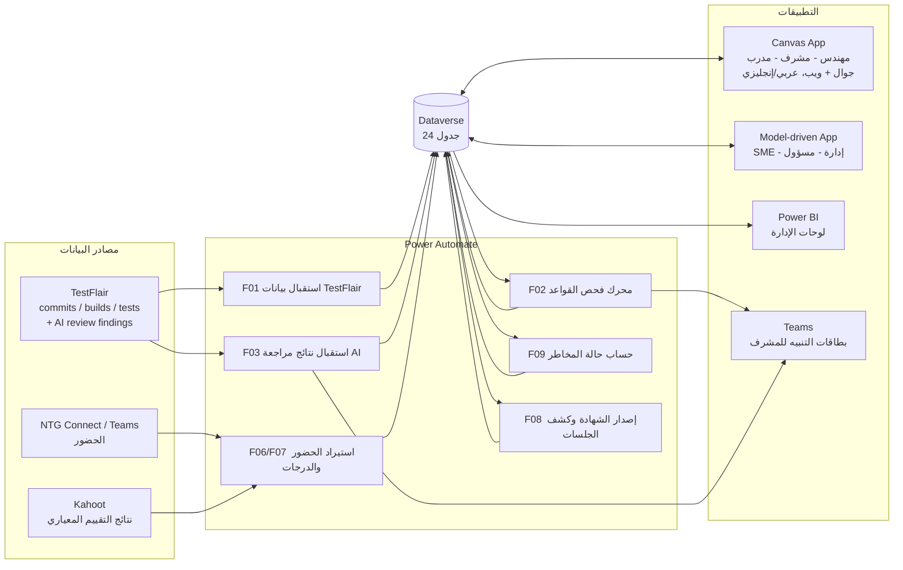

# نظام إدارة التدريب WBL (مشروع Tawwer) على Power Platform

هذا المجلد هو **حزمة بناء كاملة** لتنفيذ وثيقة BRD v0.3
("Work-Based Learning Training Management System") على Microsoft Power Platform.

| الملف | المحتوى |
|---|---|
| [`dataverse/schema.json`](dataverse/schema.json) | نموذج البيانات كاملاً (25 جدول + 26 خيار) — المصدر الوحيد للحقيقة |
| [`tools/dataverse_schema.py`](tools/dataverse_schema.py) | سكربت ينشئ الجداول والأعمدة والعلاقات في Dataverse تلقائياً ويعبّئ البيانات الأولية |
| [`data/*.csv`](data/) | بيانات أولية (المسارات، المهارات، قواعد التنبيه، قواعد المخاطر، نصوص الواجهة عربي/إنجليزي) |
| [`docs/01-data-model.md`](docs/01-data-model.md) | قاموس البيانات + مخطط العلاقات (مولّد من schema.json) |
| [`docs/02-security.md`](docs/02-security.md) | الأدوار الأمنية ومن يرى ماذا |
| [`docs/03-canvas-app.md`](docs/03-canvas-app.md) | تطبيق Canvas للمهندس والمشرف والمدرب: الشاشات ومعادلات Power Fx |
| [`docs/04-model-driven-app.md`](docs/04-model-driven-app.md) | تطبيق Model-driven للخبير (SME) والإدارة والمسؤول + Business Rules |
| [`docs/05-power-automate.md`](docs/05-power-automate.md) | 13 تدفق Power Automate (فحص القواعد، مراجعة AI، الشهادات، المخاطر...) |
| [`docs/06-power-bi.md`](docs/06-power-bi.md) | لوحات الإدارة في Power BI ومقاييس DAX |
| [`integrations/testflair-webhook.schema.json`](integrations/testflair-webhook.schema.json) | عقد البيانات بين TestFlair والنظام |

---

## 1. البنية المقترحة

**لماذا Dataverse وليس SharePoint Lists؟** المتطلبات تفرض أمان على مستوى السجل
("المهندس لا يرى سجلات غيره"، "المهندس لا يرى نتائج AI"، "فقط الخبير يعتمد المستوى").
هذا مستحيل عملياً في SharePoint ومتوفر جاهزاً في Dataverse (Security Roles + Hierarchy Security + Auditing).
التكلفة: يحتاج كل مستخدم رخصة **Power Apps Premium** (أو Per-App).

**أين يحدث "الذكاء"؟** وفق BRD القسم 2.4، المرحلة الأولى تعتمد على **TestFlair** لمراجعة الـ commits مقابل
Definition of Done. النظام يستقبل فقط *النتيجة والدليل* (رابط الـ commit، بند الـ DoD، السبب) — **لا يخرج كود العميل من NTG**.
يوجد خيار بديل (AI Builder prompt) للمشاريع المحاكاة فقط، موضّح في `05-power-automate.md`.

---

## 2. ترتيب البناء (خطوة بخطوة)

| # | الخطوة | الأداة | المدة التقريبية |
|---|---|---|---|
| 0 | إنشاء Environment جديد (Production أو Sandbox) مع Dataverse، وتفعيل اللغة العربية (Settings → Languages → Arabic) | Power Platform admin center | ساعة |
| 1 | إنشاء الجداول تلقائياً: `python3 tools/dataverse_schema.py deploy --env https://<org>.crm4.dynamics.com --arabic` | السكربت | 15 دقيقة |
| 2 | تعبئة البيانات الأولية: `python3 tools/dataverse_schema.py seed --env ...` | السكربت | 5 دقائق |
| 3 | إعداد الأدوار الأمنية و Hierarchy Security | `02-security.md` | يوم |
| 4 | بناء تطبيق Model-driven (SME/الإدارة/المسؤول) + Business Rules + Views | `04-model-driven-app.md` | 2-3 أيام |
| 5 | بناء تطبيق Canvas (المهندس/المشرف/المدرب) | `03-canvas-app.md` | 1-2 أسبوع |
| 6 | بناء تدفقات Power Automate | `05-power-automate.md` | 1-2 أسبوع |
| 7 | ربط TestFlair (webhook) وNTG Connect وKahoot | `05` + `integrations/` | حسب توفر واجهات APIs |
| 8 | تقارير Power BI وتضمينها في تطبيق الإدارة | `06-power-bi.md` | 3-5 أيام |
| 9 | اختبار على مشاريع محاكاة (Prototype) ثم Pilot | — | حسب الجدول الزمني في BRD 4.4 |

> **ملاحظة للسكربت:** يحتاج `pip install requests msal`. أول مرة جرّب `--dry-run` لترى كل ما سيُنشأ (252 عملية).
> إن لم تُفعّل العربية في البيئة، شغّله بدون `--arabic` ثم أضف الترجمات لاحقاً من Export/Import Translations.
> إن لم تتمكن من تشغيل السكربت، يمكن إنشاء كل شيء يدوياً من make.powerapps.com بالاعتماد على `docs/01-data-model.md`.

---

## 3. مصفوفة تتبع المتطلبات (Traceability)

| المتطلب | كيف يتحقق في الحل |
|---|---|
| **BR-01** سجل واحد لكل مهندس | جدول `wbl_engineer` + نموذج رئيسي بتبويبات (المشاريع، السبرنتات، التقييمات، المستويات) |
| **BR-02 / US-06** الخبير يحدد المستويات المستهدفة | `wbl_roleprofileitem`؛ صلاحية الكتابة لدور SME فقط |
| **BR-03 / US-01** جمع بيانات العمل بأقل جهد | شاشة "تسجيل عملي" (3 حقول) + F01 يجلب من TestFlair؛ الشاشة تخفي التسجيل إن كان المشروع متكاملاً |
| **BR-04** اكتشاف المشاكل في نفس السبرنت | F02 (قواعد يومياً) + F03 (نتائج AI لحظياً) |
| **BR-05** كل تنبيه يعرض الدليل | أعمدة `wbl_evidence`, `wbl_evidenceurl`, `wbl_doditem`, `wbl_reason` |
| **BR-06 / US-04** المشرف يتخذ القرار في مكان واحد | شاشة "التنبيهات" في Canvas + بطاقة Teams تفاعلية (F04) |
| **US-05** الرفض يتطلب سبباً | Business Rule على مستوى الخادم (Entity scope) + تعطيل زر الحفظ في Canvas |
| **BR-07 / US-07** الأدلة + اعتماد الخبير | `wbl_assessment` (دليل) + `wbl_competencyapproval` (قرار)؛ لا يوجد أي تدفق يحدد المستوى تلقائياً |
| **BR-08** التاريخ عبر السبرنتات | `wbl_risksnapshot`، `wbl_competencyapproval` (iscurrent)، Auditing |
| **BR-09 / US-08** لوحة الإدارة | Power BI صفحة "نظرة عامة" + "حِمل المشرفين" |
| **BR-10 / US-09** إضافة مسارات وحقول وقواعد بدون برمجة | المسارات والقواعد جداول إعداد؛ الحقول تُضاف من Maker portal؛ F02 يقرأ القواعد ديناميكياً |
| **BR-11** سجل كامل للتنبيهات والقرارات | `wbl_flagdecision` (F05) + Dataverse Auditing |
| **BR-12 / US-10** الجلسات والحضور | `wbl_session`, `wbl_attendance` + F06/F07 |
| **BR-13 / US-03 / US-11** الشهادة وكشف الجلسات | F08: يتحقق من الأهلية ويولد PDF بختم زمني؛ جلسات General Skills مستثناة |
| **BR-14 / US-12 / US-13** نتائج التقييمات الثلاثة | شاشة "تسجيل تقييم"؛ سير العمل الكامل يقبل مشاريع محاكاة فقط (تحقق في الواجهة + F11) |
| **BR-15 / US-17** أدوات التدريب | `wbl_toolkititem` + F10 تنبيه بالعناصر غير الجاهزة قبل الجلسة |
| **BR-16** حالة المخاطر | `wbl_riskrule` (قابلة للتعديل) + F09 ليلياً |
| **US-15** تقارير الإدارات وتصديرها | Power BI مع فلتر الإدارة والفترة + التصدير PDF/Excel |
| **US-16** نقاط الاحتكاك | Power BI صفحة "Friction" مع Drill-through للسجلات |
| **التقويم السنوي** | `wbl_trainingcalendar` + عرض Calendar في Model-driven |
| **واجهة عربية/إنجليزية** | Dataverse Arabic language pack (Model-driven) + جدول `wbl_uistring` وتبديل RTL في Canvas |
| **قيد NDA** | أعمدة NDA/الموافقة الأمنية على المهندس؛ F12 يمنع التسجيل في الجلسات قبل اكتمالها |

---

## 4. نقاط يجب حسمها مع أصحاب المصلحة قبل البناء

1. **الاستضافة:** BRD (3.3) تنص أن النظام "يُستضاف في مراكز بيانات NTG ما لم يُذكر خلاف ذلك".
   Power Platform خدمة سحابية من Microsoft — تحتاج **موافقة صريحة** (استثناء "unless otherwise stated")، واختيار منطقة البيانات
   المناسبة (مثلاً Saudi Arabia/UAE region إن توفرت للمستأجر). كود العميل لا يدخل Dataverse أصلاً في هذا التصميم.
2. **المنصة:** خانة Platform في BRD مكتوب فيها **AURA** — يجب تحديثها إلى Power Platform إن اعتُمد هذا الخيار.
3. **قيم القواعد:** كل الأرقام في `data/wbl_flagrule.csv` و `data/wbl_riskrule.csv` **مسودات**؛ الـ BRD يشترط أن الخبير
   والإدارة يعتمدونها (قواعد المخاطر فيها عمود `wbl_agreedbymgmt`).
4. **المهارات ومستوياتها:** `data/wbl_skill.csv` و `wbl_roleprofileitem.csv` أمثلة فقط؛ معيار NTG الفعلي يضعه الخبير.
5. **واجهات APIs:** هل يوفر TestFlair webhook؟ هل NTG Connect يصدّر تقرير الحضور؟ Kahoot يصدّر Excel — التصميم يدعم الرفع اليدوي كبديل.
6. **التراخيص:** Power Apps Premium لكل مستخدم + Power BI Pro للإدارة + (اختياري) AI Builder credits.
