# 01 - Data Model (Dataverse) / نموذج البيانات

> Generated from `powerapps/dataverse/schema.json` by `tools/dataverse_schema.py doc`. Do not edit by hand; edit the JSON and run the command again.

Publisher prefix: `wbl_`  |  Solution: `WBLTrainingManagement`

## Tables / الجداول

| Table | الجدول | Logical name | Ownership | Audit | Requirements |
|---|---|---|---|---|---|
| Departments | الإدارات | `wbl_department` | Organization | - | BR-09, US-15 |
| Tracks | المسارات | `wbl_track` | Organization | Yes | BR-01, BR-02, BR-10 |
| Skills | المهارات (معيار NTG) | `wbl_skill` | Organization | Yes | BR-02, BO-03 |
| Skill Level Descriptors | أوصاف مستويات المهارات | `wbl_skillleveldescriptor` | Organization | Yes | BR-02 |
| Role Profile Items | الملف الوظيفي (المستويات المستهدفة) | `wbl_roleprofileitem` | Organization | Yes | BR-02, US-06 |
| Training Calendars | تقاويم التدريب | `wbl_trainingcalendar` | Organization | - | Scope: annual training calendar |
| Engineers | المهندسون | `wbl_engineer` | User | Yes | BR-01, BR-16, US-02, US-08, US-14, Constraint: NDA |
| Projects | المشاريع | `wbl_project` | Organization | Yes | BR-03, BR-04, US-13, Constraint: client data |
| Project Assignments | إسنادات المشاريع | `wbl_projectassignment` | User | Yes | BR-01 |
| Sprints | السبرنتات | `wbl_sprint` | Organization | - | BR-03, BR-08 |
| Work Logs | سجلات العمل | `wbl_worklog` | User | Yes | BR-03, US-01 |
| Work Activities | أنشطة العمل | `wbl_workactivity` | User | - | BR-03, BR-04, BR-05 |
| Flag Rules | قواعد التنبيه | `wbl_flagrule` | Organization | Yes | BR-04, BR-10, Risk: false flags |
| Flags | التنبيهات | `wbl_flag` | User | Yes | BR-04, BR-05, BR-06, BR-11, US-04, US-05 |
| Flag Decisions | سجل قرارات التنبيهات | `wbl_flagdecision` | User | Yes | BR-11, US-05, US-16 |
| Training Sessions | الجلسات التدريبية | `wbl_session` | Organization | Yes | BR-12, BR-13, Scope: annual calendar, US-10 |
| Session Attendances | الحضور ونتائج الجلسات | `wbl_attendance` | User | Yes | BR-12, BR-13, US-10, US-11 |
| Rubrics | معايير التقييم (Rubrics) | `wbl_rubric` | Organization | Yes | US-13 |
| Assessment Results | نتائج التقييم (الأدلة) | `wbl_assessment` | User | Yes | BR-07, BR-14, US-07, US-12, US-13 |
| Competency Approvals | اعتمادات الكفاءة | `wbl_competencyapproval` | User | Yes | BR-07, BR-08, US-02, US-07, US-14 |
| Certificates | الشهادات | `wbl_certificate` | User | Yes | BR-13, US-03 |
| Toolkit Items | أدوات التدريب | `wbl_toolkititem` | Organization | Yes | BR-15, US-17 |
| Risk Rules | قواعد المخاطر | `wbl_riskrule` | Organization | Yes | BR-16 |
| Risk Snapshots | سجل المخاطر | `wbl_risksnapshot` | User | - | BR-08, BR-16 |
| UI Strings | نصوص الواجهة | `wbl_uistring` | Organization | - | Constraint: English and Arabic UI |

## Relationships / العلاقات

```mermaid
erDiagram
    DEPARTMENT ||--o{ TRACK : "wbl_departmentid"
    SKILL ||--o{ SKILLLEVELDESCRIPTOR : "wbl_skillid"
    TRACK ||--o{ ROLEPROFILEITEM : "wbl_trackid"
    SKILL ||--o{ ROLEPROFILEITEM : "wbl_skillid"
    TRACK ||--o{ TRAININGCALENDAR : "wbl_trackid"
    SYSTEMUSER ||--o{ ENGINEER : "wbl_useraccountid"
    SYSTEMUSER ||--o{ ENGINEER : "wbl_supervisorid"
    TRACK ||--o{ ENGINEER : "wbl_trackid"
    DEPARTMENT ||--o{ ENGINEER : "wbl_departmentid"
    TRAININGCALENDAR ||--o{ ENGINEER : "wbl_calendarid"
    TRACK ||--o{ PROJECT : "wbl_trackid"
    ENGINEER ||--o{ PROJECTASSIGNMENT : "wbl_engineerid"
    PROJECT ||--o{ PROJECTASSIGNMENT : "wbl_projectid"
    PROJECT ||--o{ SPRINT : "wbl_projectid"
    ENGINEER ||--o{ WORKLOG : "wbl_engineerid"
    SPRINT ||--o{ WORKLOG : "wbl_sprintid"
    ENGINEER ||--o{ WORKACTIVITY : "wbl_engineerid"
    SPRINT ||--o{ WORKACTIVITY : "wbl_sprintid"
    TRACK ||--o{ FLAGRULE : "wbl_trackid"
    ENGINEER ||--o{ FLAG : "wbl_engineerid"
    SPRINT ||--o{ FLAG : "wbl_sprintid"
    FLAGRULE ||--o{ FLAG : "wbl_ruleid"
    WORKACTIVITY ||--o{ FLAG : "wbl_workactivityid"
    SYSTEMUSER ||--o{ FLAG : "wbl_decidedbyid"
    FLAG ||--o{ FLAGDECISION : "wbl_flagid"
    SYSTEMUSER ||--o{ FLAGDECISION : "wbl_decidedbyid"
    TRACK ||--o{ SESSION : "wbl_trackid"
    TRAININGCALENDAR ||--o{ SESSION : "wbl_calendarid"
    SYSTEMUSER ||--o{ SESSION : "wbl_instructorid"
    SESSION ||--o{ ATTENDANCE : "wbl_sessionid"
    ENGINEER ||--o{ ATTENDANCE : "wbl_engineerid"
    SYSTEMUSER ||--o{ ATTENDANCE : "wbl_confirmedbyid"
    TRACK ||--o{ RUBRIC : "wbl_trackid"
    SKILL ||--o{ RUBRIC : "wbl_skillid"
    ENGINEER ||--o{ ASSESSMENT : "wbl_engineerid"
    SKILL ||--o{ ASSESSMENT : "wbl_skillid"
    SESSION ||--o{ ASSESSMENT : "wbl_sessionid"
    PROJECT ||--o{ ASSESSMENT : "wbl_projectid"
    RUBRIC ||--o{ ASSESSMENT : "wbl_rubricid"
    SYSTEMUSER ||--o{ ASSESSMENT : "wbl_assessedbyid"
    ENGINEER ||--o{ COMPETENCYAPPROVAL : "wbl_engineerid"
    SKILL ||--o{ COMPETENCYAPPROVAL : "wbl_skillid"
    SYSTEMUSER ||--o{ COMPETENCYAPPROVAL : "wbl_approvedbyid"
    ENGINEER ||--o{ CERTIFICATE : "wbl_engineerid"
    TRACK ||--o{ CERTIFICATE : "wbl_trackid"
    SYSTEMUSER ||--o{ CERTIFICATE : "wbl_issuedbyid"
    TRACK ||--o{ TOOLKITITEM : "wbl_trackid"
    SESSION ||--o{ TOOLKITITEM : "wbl_sessionid"
    ENGINEER ||--o{ RISKSNAPSHOT : "wbl_engineerid"
    SPRINT ||--o{ RISKSNAPSHOT : "wbl_sprintid"
```

## Department / إدارة (`wbl_department`)

Ownership: **OrganizationOwned**. Audit: **off**. Covers: BR-09, US-15.

| Column | العمود | Logical name | Type | Required | Notes |
|---|---|---|---|---|---|
| Name | الاسم | `wbl_name` | Text | Yes | primary name |
| Name (Arabic) | الاسم بالعربي | `wbl_namear` | Text |  |  |
| Code | الرمز | `wbl_code` | Text |  |  |

## Track / مسار (`wbl_track`)

Ownership: **OrganizationOwned**. Audit: **on**. Covers: BR-01, BR-02, BR-10.

| Column | العمود | Logical name | Type | Required | Notes |
|---|---|---|---|---|---|
| Name | الاسم | `wbl_name` | Text | Yes | primary name |
| Name (Arabic) | الاسم بالعربي | `wbl_namear` | Text |  |  |
| Code | الرمز | `wbl_code` | Text | Yes |  |
| Department | الإدارة | `wbl_departmentid` | Lookup |  | → `wbl_department` |
| Issues Certificate | يمنح شهادة | `wbl_certificateenabled` | Yes/No |  |  |
| Active | نشط | `wbl_isactive` | Yes/No |  |  |
| Description | الوصف | `wbl_description` | Multiline text |  |  |

## Skill / مهارة (`wbl_skill`)

Ownership: **OrganizationOwned**. Audit: **on**. Covers: BR-02, BO-03.

| Column | العمود | Logical name | Type | Required | Notes |
|---|---|---|---|---|---|
| Name | الاسم | `wbl_name` | Text | Yes | primary name |
| Name (Arabic) | الاسم بالعربي | `wbl_namear` | Text |  |  |
| Code | الرمز | `wbl_code` | Text | Yes |  |
| SFIA 9 Code | رمز SFIA 9 | `wbl_sfiacode` | Text |  |  |
| Category | الفئة | `wbl_category` | Choice |  | global choice `wbl_skillcategory` |
| Description | الوصف | `wbl_description` | Multiline text |  |  |

## Skill Level Descriptor / وصف مستوى المهارة (`wbl_skillleveldescriptor`)

Ownership: **OrganizationOwned**. Audit: **on**. Covers: BR-02.

| Column | العمود | Logical name | Type | Required | Notes |
|---|---|---|---|---|---|
| Name | الاسم | `wbl_name` | Text | Yes | primary name |
| Skill | المهارة | `wbl_skillid` | Lookup | Yes | → `wbl_skill` |
| Level (1-7) | المستوى (1-7) | `wbl_level` | Whole number | Yes | 1 … 7 |
| Descriptor | الوصف | `wbl_descriptor` | Multiline text |  |  |
| Descriptor (Arabic) | الوصف بالعربي | `wbl_descriptorar` | Multiline text |  |  |

## Role Profile Item / عنصر الملف الوظيفي (`wbl_roleprofileitem`)

Ownership: **OrganizationOwned**. Audit: **on**. Covers: BR-02, US-06.

| Column | العمود | Logical name | Type | Required | Notes |
|---|---|---|---|---|---|
| Name | الاسم | `wbl_name` | Text | Yes | primary name |
| Track | المسار | `wbl_trackid` | Lookup | Yes | → `wbl_track` |
| Skill | المهارة | `wbl_skillid` | Lookup | Yes | → `wbl_skill` |
| Target Level | المستوى المستهدف | `wbl_targetlevel` | Whole number | Yes | 1 … 7 |
| Notes | ملاحظات | `wbl_notes` | Multiline text |  |  |

## Training Calendar / تقويم التدريب (`wbl_trainingcalendar`)

Ownership: **OrganizationOwned**. Audit: **off**. Covers: Scope: annual training calendar.

| Column | العمود | Logical name | Type | Required | Notes |
|---|---|---|---|---|---|
| Name | الاسم | `wbl_name` | Text | Yes | primary name |
| Year | السنة | `wbl_year` | Whole number | Yes | 2025 … 2100 |
| Track | المسار | `wbl_trackid` | Lookup |  | → `wbl_track` |
| Published | منشور | `wbl_ispublished` | Yes/No |  |  |

## Engineer / مهندس (`wbl_engineer`)

Ownership: **UserOwned**. Audit: **on**. Covers: BR-01, BR-16, US-02, US-08, US-14, Constraint: NDA.

| Column | العمود | Logical name | Type | Required | Notes |
|---|---|---|---|---|---|
| Full Name | الاسم الكامل | `wbl_name` | Text | Yes | primary name |
| Full Name (Arabic) | الاسم الكامل بالعربي | `wbl_namear` | Text |  |  |
| Email | البريد الإلكتروني | `wbl_email` | Email | Yes |  |
| Employee No. | الرقم الوظيفي | `wbl_employeeno` | Text |  |  |
| User Account | حساب المستخدم | `wbl_useraccountid` | Lookup | Yes | → `systemuser` |
| Supervisor | المشرف | `wbl_supervisorid` | Lookup | Yes | → `systemuser` |
| Track | المسار | `wbl_trackid` | Lookup | Yes | → `wbl_track` |
| Department | الإدارة | `wbl_departmentid` | Lookup |  | → `wbl_department` |
| Training Calendar (Intake) | تقويم التدريب (الدفعة) | `wbl_calendarid` | Lookup |  | → `wbl_trainingcalendar` |
| Start Date | تاريخ البدء | `wbl_startdate` | Date only |  |  |
| NDA Signed | تم توقيع اتفاقية عدم الإفصاح | `wbl_ndasigned` | Yes/No |  |  |
| NDA Signed On | تاريخ توقيع الاتفاقية | `wbl_ndasignedon` | Date only |  |  |
| Security Permissions Approved | تمت الموافقة على الصلاحيات الأمنية | `wbl_securityapproved` | Yes/No |  |  |
| Source Code Access Approved | موافقة الإدارة على الوصول للكود | `wbl_sourcecodeaccess` | Yes/No |  |  |
| Risk Status | حالة المخاطر | `wbl_riskstatus` | Choice |  | global choice `wbl_riskstatus` |
| Risk Reason | سبب حالة المخاطر | `wbl_riskreason` | Multiline text |  |  |
| Risk Updated On | تاريخ تحديث المخاطر | `wbl_riskupdatedon` | Date and time |  |  |

## Project / مشروع (`wbl_project`)

Ownership: **OrganizationOwned**. Audit: **on**. Covers: BR-03, BR-04, US-13, Constraint: client data.

| Column | العمود | Logical name | Type | Required | Notes |
|---|---|---|---|---|---|
| Name | الاسم | `wbl_name` | Text | Yes | primary name |
| Project Type | نوع المشروع | `wbl_projecttype` | Choice | Yes | global choice `wbl_projecttype` |
| Client | العميل | `wbl_client` | Text |  |  |
| Track | المسار | `wbl_trackid` | Lookup |  | → `wbl_track` |
| Definition of Done | تعريف الإنجاز (DoD) | `wbl_definitionofdone` | Multiline text |  |  |
| Tool Integration | تكامل الأداة | `wbl_toolintegration` | Choice |  | global choice `wbl_toolintegration` |
| Client Permits Tool Data Use | العميل يسمح باستخدام بيانات الأداة | `wbl_clientpermitsdata` | Yes/No |  |  |
| Client Code Must Stay Inside NTG | يجب أن يبقى كود العميل داخل NTG | `wbl_codestaysinntg` | Yes/No |  |  |
| Repository URL | رابط المستودع | `wbl_repositoryurl` | URL |  |  |
| Start Date | تاريخ البدء | `wbl_startdate` | Date only |  |  |
| End Date | تاريخ الانتهاء | `wbl_enddate` | Date only |  |  |

## Project Assignment / إسناد مشروع (`wbl_projectassignment`)

Ownership: **UserOwned**. Audit: **on**. Covers: BR-01.

| Column | العمود | Logical name | Type | Required | Notes |
|---|---|---|---|---|---|
| Name | الاسم | `wbl_name` | Text | Yes | primary name |
| Engineer | المهندس | `wbl_engineerid` | Lookup | Yes | → `wbl_engineer` |
| Project | المشروع | `wbl_projectid` | Lookup | Yes | → `wbl_project` |
| Role in Project | الدور في المشروع | `wbl_role` | Text |  |  |
| From | من | `wbl_fromdate` | Date only |  |  |
| To | إلى | `wbl_todate` | Date only |  |  |

## Sprint / سبرنت (`wbl_sprint`)

Ownership: **OrganizationOwned**. Audit: **off**. Covers: BR-03, BR-08.

| Column | العمود | Logical name | Type | Required | Notes |
|---|---|---|---|---|---|
| Name | الاسم | `wbl_name` | Text | Yes | primary name |
| Project | المشروع | `wbl_projectid` | Lookup | Yes | → `wbl_project` |
| Sprint No. | رقم السبرنت | `wbl_sprintnumber` | Whole number |  | 1 … 1000 |
| Start Date | تاريخ البدء | `wbl_startdate` | Date only | Yes |  |
| End Date | تاريخ الانتهاء | `wbl_enddate` | Date only | Yes |  |
| Sprint Status | حالة السبرنت | `wbl_sprintstatus` | Choice |  | global choice `wbl_sprintstatus` |

## Work Log / سجل عمل (`wbl_worklog`)

Ownership: **UserOwned**. Audit: **on**. Covers: BR-03, US-01.

| Column | العمود | Logical name | Type | Required | Notes |
|---|---|---|---|---|---|
| Title | العنوان | `wbl_name` | Text | Yes | primary name |
| Engineer | المهندس | `wbl_engineerid` | Lookup | Yes | → `wbl_engineer` |
| Sprint | السبرنت | `wbl_sprintid` | Lookup | Yes | → `wbl_sprint` |
| Log Date | التاريخ | `wbl_logdate` | Date only | Yes |  |
| Hours | الساعات | `wbl_hours` | Decimal |  | 0 … 24 |
| What I did | ماذا أنجزت | `wbl_summary` | Multiline text |  |  |
| Task Reference | مرجع المهمة | `wbl_taskreference` | Text |  |  |
| Link (commit / PR / document) | رابط (commit / PR / مستند) | `wbl_linkurl` | URL |  |  |
| Source | المصدر | `wbl_source` | Choice |  | global choice `wbl_worksource` |

## Work Activity / نشاط عمل (`wbl_workactivity`)

Ownership: **UserOwned**. Audit: **off**. Covers: BR-03, BR-04, BR-05.

| Column | العمود | Logical name | Type | Required | Notes |
|---|---|---|---|---|---|
| Title | العنوان | `wbl_name` | Text | Yes | primary name |
| Engineer | المهندس | `wbl_engineerid` | Lookup | Yes | → `wbl_engineer` |
| Sprint | السبرنت | `wbl_sprintid` | Lookup |  | → `wbl_sprint` |
| Activity Type | نوع النشاط | `wbl_activitytype` | Choice | Yes | global choice `wbl_activitytype` |
| Occurred On | وقت الحدوث | `wbl_occurredon` | Date and time | Yes |  |
| Due Date | تاريخ الاستحقاق | `wbl_duedate` | Date and time |  |  |
| Result | النتيجة | `wbl_result` | Choice |  | global choice `wbl_activityresult` |
| Link | الرابط | `wbl_url` | URL |  |  |
| External ID | المعرّف الخارجي | `wbl_externalid` | Text |  |  |
| Source | المصدر | `wbl_source` | Choice |  | global choice `wbl_worksource` |
| Details | التفاصيل | `wbl_details` | Multiline text |  |  |

## Flag Rule / قاعدة تنبيه (`wbl_flagrule`)

Ownership: **OrganizationOwned**. Audit: **on**. Covers: BR-04, BR-10, Risk: false flags.

| Column | العمود | Logical name | Type | Required | Notes |
|---|---|---|---|---|---|
| Name | الاسم | `wbl_name` | Text | Yes | primary name |
| Name (Arabic) | الاسم بالعربي | `wbl_namear` | Text |  |  |
| Rule Type | نوع القاعدة | `wbl_ruletype` | Choice | Yes | global choice `wbl_ruletype` |
| Category | الفئة | `wbl_flagcategory` | Choice |  | global choice `wbl_flagcategory` |
| Severity | الخطورة | `wbl_severity` | Choice |  | global choice `wbl_severity` |
| Threshold | الحد | `wbl_threshold` | Whole number |  | 0 … 1000 |
| Threshold Unit | وحدة الحد | `wbl_thresholdunit` | Text |  |  |
| Track (blank = all) | المسار (فارغ = الكل) | `wbl_trackid` | Lookup |  | → `wbl_track` |
| Active | نشطة | `wbl_isactive` | Yes/No |  |  |
| Description | الوصف | `wbl_description` | Multiline text |  |  |

## Flag / تنبيه (`wbl_flag`)

Ownership: **UserOwned**. Audit: **on**. Covers: BR-04, BR-05, BR-06, BR-11, US-04, US-05.

| Column | العمود | Logical name | Type | Required | Notes |
|---|---|---|---|---|---|
| Title | العنوان | `wbl_name` | Text | Yes | primary name |
| Engineer | المهندس | `wbl_engineerid` | Lookup | Yes | → `wbl_engineer` |
| Sprint | السبرنت | `wbl_sprintid` | Lookup |  | → `wbl_sprint` |
| Rule | القاعدة | `wbl_ruleid` | Lookup |  | → `wbl_flagrule` |
| Work Activity | نشاط العمل | `wbl_workactivityid` | Lookup |  | → `wbl_workactivity` |
| Source | المصدر | `wbl_flagsource` | Choice | Yes | global choice `wbl_flagsource` |
| Category | الفئة | `wbl_flagcategory` | Choice |  | global choice `wbl_flagcategory` |
| Severity | الخطورة | `wbl_severity` | Choice |  | global choice `wbl_severity` |
| Flag Status | حالة التنبيه | `wbl_flagstatus` | Choice | Yes | global choice `wbl_flagstatus` |
| Detected On | تاريخ الاكتشاف | `wbl_detectedon` | Date and time |  |  |
| Evidence | الدليل | `wbl_evidence` | Multiline text |  |  |
| Evidence Link (commit) | رابط الدليل (commit) | `wbl_evidenceurl` | URL |  |  |
| Definition of Done Item | بند تعريف الإنجاز | `wbl_doditem` | Multiline text |  |  |
| Reason (from rule / AI) | السبب (من القاعدة / الذكاء الاصطناعي) | `wbl_reason` | Multiline text |  |  |
| Decision Reason | سبب القرار | `wbl_decisionreason` | Multiline text |  |  |
| Decided By | صاحب القرار | `wbl_decidedbyid` | Lookup |  | → `systemuser` |
| Decided On | تاريخ القرار | `wbl_decidedon` | Date and time |  |  |

## Flag Decision / قرار تنبيه (`wbl_flagdecision`)

Ownership: **UserOwned**. Audit: **on**. Covers: BR-11, US-05, US-16.

| Column | العمود | Logical name | Type | Required | Notes |
|---|---|---|---|---|---|
| Title | العنوان | `wbl_name` | Text | Yes | primary name |
| Flag | التنبيه | `wbl_flagid` | Lookup | Yes | → `wbl_flag` |
| New Status | الحالة الجديدة | `wbl_newstatus` | Choice |  | global choice `wbl_flagstatus` |
| Reason | السبب | `wbl_reason` | Multiline text |  |  |
| Decided By | صاحب القرار | `wbl_decidedbyid` | Lookup |  | → `systemuser` |
| Decided On | تاريخ القرار | `wbl_decidedon` | Date and time |  |  |

## Training Session / جلسة تدريبية (`wbl_session`)

Ownership: **OrganizationOwned**. Audit: **on**. Covers: BR-12, BR-13, Scope: annual calendar, US-10.

| Column | العمود | Logical name | Type | Required | Notes |
|---|---|---|---|---|---|
| Title | العنوان | `wbl_name` | Text | Yes | primary name |
| Title (Arabic) | العنوان بالعربي | `wbl_titlear` | Text |  |  |
| Session Type | نوع الجلسة | `wbl_sessiontype` | Choice | Yes | global choice `wbl_sessiontype` |
| Track (blank for General Skills) | المسار (فارغ للمهارات العامة) | `wbl_trackid` | Lookup |  | → `wbl_track` |
| Training Calendar | تقويم التدريب | `wbl_calendarid` | Lookup |  | → `wbl_trainingcalendar` |
| Instructor / Trainer | المدرب | `wbl_instructorid` | Lookup | Yes | → `systemuser` |
| Topic | الموضوع | `wbl_topic` | Multiline text |  |  |
| Starts On | يبدأ في | `wbl_startson` | Date and time | Yes |  |
| Ends On | ينتهي في | `wbl_endson` | Date and time |  |  |
| Platform | المنصة | `wbl_platform` | Choice |  | global choice `wbl_deliveryplatform` |
| Meeting Link | رابط الاجتماع | `wbl_meetingurl` | URL |  |  |
| Pass Mark % | درجة النجاح % | `wbl_passmark` | Decimal |  | 0 … 100 |
| Late After (minutes) | يعتبر متأخراً بعد (دقائق) | `wbl_latethreshold` | Whole number |  | 0 … 240 |

## Session Attendance / حضور جلسة (`wbl_attendance`)

Ownership: **UserOwned**. Audit: **on**. Covers: BR-12, BR-13, US-10, US-11.

| Column | العمود | Logical name | Type | Required | Notes |
|---|---|---|---|---|---|
| Title | العنوان | `wbl_name` | Text | Yes | primary name |
| Session | الجلسة | `wbl_sessionid` | Lookup | Yes | → `wbl_session` |
| Engineer | المهندس | `wbl_engineerid` | Lookup | Yes | → `wbl_engineer` |
| Attendance | الحضور | `wbl_attendancestatus` | Choice |  | global choice `wbl_attendancestatus` |
| Join Time | وقت الدخول | `wbl_jointime` | Date and time |  |  |
| Minutes Late | دقائق التأخير | `wbl_minuteslate` | Whole number |  | 0 … 1440 |
| Attendance Source | مصدر الحضور | `wbl_attendancesource` | Choice |  | global choice `wbl_datasource` |
| Assessment Score % | درجة التقييم % | `wbl_score` | Decimal |  | 0 … 100 |
| Score Source | مصدر الدرجة | `wbl_scoresource` | Choice |  | global choice `wbl_datasource` |
| Passed | ناجح | `wbl_passed` | Yes/No |  |  |
| Confirmed by Instructor | مؤكد من المدرب | `wbl_isconfirmed` | Yes/No |  |  |
| Confirmed By | أكده | `wbl_confirmedbyid` | Lookup |  | → `systemuser` |
| Confirmed On | تاريخ التأكيد | `wbl_confirmedon` | Date and time |  |  |

## Rubric / معيار تقييم (`wbl_rubric`)

Ownership: **OrganizationOwned**. Audit: **on**. Covers: US-13.

| Column | العمود | Logical name | Type | Required | Notes |
|---|---|---|---|---|---|
| Name | الاسم | `wbl_name` | Text | Yes | primary name |
| Track | المسار | `wbl_trackid` | Lookup |  | → `wbl_track` |
| Skill | المهارة | `wbl_skillid` | Lookup |  | → `wbl_skill` |
| Criteria | المعايير | `wbl_criteria` | Multiline text |  |  |
| Max Score | الدرجة القصوى | `wbl_maxscore` | Whole number |  | 1 … 1000 |
| Version | الإصدار | `wbl_version` | Text |  |  |

## Assessment Result / نتيجة تقييم (`wbl_assessment`)

Ownership: **UserOwned**. Audit: **on**. Covers: BR-07, BR-14, US-07, US-12, US-13.

| Column | العمود | Logical name | Type | Required | Notes |
|---|---|---|---|---|---|
| Title | العنوان | `wbl_name` | Text | Yes | primary name |
| Engineer | المهندس | `wbl_engineerid` | Lookup | Yes | → `wbl_engineer` |
| Skill | المهارة | `wbl_skillid` | Lookup | Yes | → `wbl_skill` |
| Assessment Type | نوع التقييم | `wbl_assessmenttype` | Choice | Yes | global choice `wbl_assessmenttype` |
| Session | الجلسة | `wbl_sessionid` | Lookup |  | → `wbl_session` |
| Simulated Project | المشروع المحاكى | `wbl_projectid` | Lookup |  | → `wbl_project` |
| Rubric | معيار التقييم | `wbl_rubricid` | Lookup |  | → `wbl_rubric` |
| Task | المهمة | `wbl_task` | Multiline text |  |  |
| What was observed / engineer actions | ما تمت ملاحظته / ما قام به المهندس | `wbl_observation` | Multiline text |  |  |
| Score | الدرجة | `wbl_score` | Decimal |  | 0 … 1000 |
| Max Score | الدرجة القصوى | `wbl_maxscore` | Decimal |  | 0 … 1000 |
| Indicative Level (not final) | المستوى الاسترشادي (غير نهائي) | `wbl_indicativelevel` | Whole number |  | 1 … 7 |
| Deliverable Link | رابط المخرج | `wbl_deliverableurl` | URL |  |  |
| External Source (e.g. Kahoot) | المصدر الخارجي (مثل Kahoot) | `wbl_externalsource` | Text |  |  |
| Supporting Evidence Only | دليل داعم فقط | `wbl_supportingonly` | Yes/No |  |  |
| Assessed By | المُقيّم | `wbl_assessedbyid` | Lookup |  | → `systemuser` |
| Assessed On | تاريخ التقييم | `wbl_assessedon` | Date and time |  |  |

## Competency Approval / اعتماد كفاءة (`wbl_competencyapproval`)

Ownership: **UserOwned**. Audit: **on**. Covers: BR-07, BR-08, US-02, US-07, US-14.

| Column | العمود | Logical name | Type | Required | Notes |
|---|---|---|---|---|---|
| Title | العنوان | `wbl_name` | Text | Yes | primary name |
| Engineer | المهندس | `wbl_engineerid` | Lookup | Yes | → `wbl_engineer` |
| Skill | المهارة | `wbl_skillid` | Lookup | Yes | → `wbl_skill` |
| Target Level | المستوى المستهدف | `wbl_targetlevel` | Whole number |  | 1 … 7 |
| Approved Level | المستوى المعتمد | `wbl_approvedlevel` | Whole number |  | 0 … 7 |
| Gap (Target - Approved) | الفجوة (المستهدف - المعتمد) | `wbl_gap` | Whole number |  | -7 … 7 |
| Decision | القرار | `wbl_decision` | Choice | Yes | global choice `wbl_approvaldecision` |
| SME Comments | ملاحظات الخبير | `wbl_comments` | Multiline text |  |  |
| Approved By (SME) | اعتمده (الخبير) | `wbl_approvedbyid` | Lookup |  | → `systemuser` |
| Approved On | تاريخ الاعتماد | `wbl_approvedon` | Date and time |  |  |
| Is Current | الحالي | `wbl_iscurrent` | Yes/No |  |  |

## Certificate / شهادة (`wbl_certificate`)

Ownership: **UserOwned**. Audit: **on**. Covers: BR-13, US-03.

| Column | العمود | Logical name | Type | Required | Notes |
|---|---|---|---|---|---|
| Certificate No. | رقم الشهادة | `wbl_name` | Text | Yes | autonumber `NTG-WBL-{DATETIMEUTC:yyyy}-{SEQNUM:5}` |
| Engineer | المهندس | `wbl_engineerid` | Lookup | Yes | → `wbl_engineer` |
| Track | المسار | `wbl_trackid` | Lookup | Yes | → `wbl_track` |
| Issued On (time stamp) | تاريخ ووقت الإصدار | `wbl_issuedon` | Date and time |  |  |
| Status | الحالة | `wbl_certificatestatus` | Choice |  | global choice `wbl_certificatestatus` |
| Certificate (PDF) | الشهادة (PDF) | `wbl_certificatefile` | File |  |  |
| Transcript (PDF) | كشف الجلسات (PDF) | `wbl_transcriptfile` | File |  |  |
| Issued By | أصدرها | `wbl_issuedbyid` | Lookup |  | → `systemuser` |

## Toolkit Item / عنصر أدوات التدريب (`wbl_toolkititem`)

Ownership: **OrganizationOwned**. Audit: **on**. Covers: BR-15, US-17.

| Column | العمود | Logical name | Type | Required | Notes |
|---|---|---|---|---|---|
| Name | الاسم | `wbl_name` | Text | Yes | primary name |
| Track | المسار | `wbl_trackid` | Lookup |  | → `wbl_track` |
| Session | الجلسة | `wbl_sessionid` | Lookup |  | → `wbl_session` |
| Item Type | نوع العنصر | `wbl_itemtype` | Choice | Yes | global choice `wbl_toolkititemtype` |
| Delivery Mode | طريقة التقديم | `wbl_deliverymode` | Choice |  | global choice `wbl_deliverymode` |
| Readiness | الجاهزية | `wbl_readiness` | Choice | Yes | global choice `wbl_readiness` |
| Qty Required | الكمية المطلوبة | `wbl_qtyrequired` | Whole number |  | 0 … 100000 |
| Qty Ready | الكمية الجاهزة | `wbl_qtyready` | Whole number |  | 0 … 100000 |
| Responsible | المسؤول | `wbl_responsible` | Text |  |  |
| Needed By | مطلوب قبل | `wbl_duedate` | Date only |  |  |
| Notes | ملاحظات | `wbl_notes` | Multiline text |  |  |

## Risk Rule / قاعدة مخاطر (`wbl_riskrule`)

Ownership: **OrganizationOwned**. Audit: **on**. Covers: BR-16.

| Column | العمود | Logical name | Type | Required | Notes |
|---|---|---|---|---|---|
| Name | الاسم | `wbl_name` | Text | Yes | primary name |
| Metric | المؤشر | `wbl_metric` | Choice | Yes | global choice `wbl_riskmetric` |
| Operator | المعامل | `wbl_operator` | Choice | Yes | global choice `wbl_operator` |
| Threshold | الحد | `wbl_threshold` | Decimal | Yes | -1000 … 1000 |
| Resulting Status | الحالة الناتجة | `wbl_resultstatus` | Choice | Yes | global choice `wbl_riskstatus` |
| Priority (1 = first) | الأولوية (1 = الأولى) | `wbl_priority` | Whole number |  | 1 … 100 |
| Active | نشطة | `wbl_isactive` | Yes/No |  |  |
| Agreed by Management | موافقة الإدارة | `wbl_agreedbymgmt` | Yes/No |  |  |
| Description | الوصف | `wbl_description` | Multiline text |  |  |

## Risk Snapshot / لقطة مخاطر (`wbl_risksnapshot`)

Ownership: **UserOwned**. Audit: **off**. Covers: BR-08, BR-16.

| Column | العمود | Logical name | Type | Required | Notes |
|---|---|---|---|---|---|
| Title | العنوان | `wbl_name` | Text | Yes | primary name |
| Engineer | المهندس | `wbl_engineerid` | Lookup | Yes | → `wbl_engineer` |
| Sprint | السبرنت | `wbl_sprintid` | Lookup |  | → `wbl_sprint` |
| Risk Status | حالة المخاطر | `wbl_riskstatus` | Choice |  | global choice `wbl_riskstatus` |
| Reason | السبب | `wbl_reason` | Multiline text |  |  |
| Calculated On | تاريخ الحساب | `wbl_calculatedon` | Date and time |  |  |
| Open Flags | التنبيهات المفتوحة | `wbl_openflags` | Whole number |  | 0 … 10000 |
| Attendance Rate % | نسبة الحضور % | `wbl_attendancerate` | Decimal |  | 0 … 100 |
| Punctuality Rate % | نسبة الالتزام بالوقت % | `wbl_punctualityrate` | Decimal |  | 0 … 100 |
| Average Score % | متوسط الدرجات % | `wbl_avgscore` | Decimal |  | 0 … 100 |
| Max Skill Gap | أكبر فجوة | `wbl_maxgap` | Whole number |  | -7 … 7 |

## UI String / نص الواجهة (`wbl_uistring`)

Ownership: **OrganizationOwned**. Audit: **off**. Covers: Constraint: English and Arabic UI.

| Column | العمود | Logical name | Type | Required | Notes |
|---|---|---|---|---|---|
| Key | المفتاح | `wbl_name` | Text | Yes | primary name |
| English | الإنجليزية | `wbl_english` | Text |  |  |
| Arabic | العربية | `wbl_arabic` | Text |  |  |

## Global choices / الخيارات

| Choice | الخيار | Name | Options (EN / AR) |
|---|---|---|---|
| Project Type | نوع المشروع | `wbl_projecttype` | Real / حقيقي; Simulated / محاكى |
| Tool Integration | تكامل الأداة | `wbl_toolintegration` | TestFlair / TestFlair; Jira / Jira; Azure DevOps / Azure DevOps; Git / Git; None (manual logs) / لا يوجد (سجلات يدوية) |
| Sprint Status | حالة السبرنت | `wbl_sprintstatus` | Planned / مخطط; Active / نشط; Closed / مغلق |
| Work Data Source | مصدر بيانات العمل | `wbl_worksource` | Manual / يدوي; TestFlair / TestFlair; Jira / Jira; Azure DevOps / Azure DevOps; Git / Git |
| Activity Type | نوع النشاط | `wbl_activitytype` | Commit / Commit; Build / Build; Test Run / تشغيل اختبارات; Task Update / تحديث مهمة |
| Activity Result | نتيجة النشاط | `wbl_activityresult` | Success / نجاح; Failed / فشل; Not Applicable / لا ينطبق |
| Flag Source | مصدر التنبيه | `wbl_flagsource` | Rule check / فحص قاعدة; AI review / مراجعة الذكاء الاصطناعي; Pattern detection / اكتشاف الأنماط |
| Flag Category | فئة التنبيه | `wbl_flagcategory` | Performance / الأداء; Conduct / السلوك المهني |
| Severity | الخطورة | `wbl_severity` | Low / منخفضة; Medium / متوسطة; High / عالية |
| Flag Status | حالة التنبيه | `wbl_flagstatus` | New / جديد; Accepted / مقبول; Dismissed / مرفوض; Resolved / تم الحل; Escalated / مُصعّد |
| Rule Type | نوع القاعدة | `wbl_ruletype` | Late commit / Commit متأخر; Inactivity / عدم نشاط; Failed build / Build فاشل; Failed tests / اختبارات فاشلة; Missing work log / سجل عمل مفقود; Absence / غياب; Late attendance / تأخر في الحضور |
| Skill Category | فئة المهارة | `wbl_skillcategory` | Technical skill / مهارة تقنية; Generic attribute / سمة عامة; Business skill / مهارة أعمال |
| Session Type | نوع الجلسة | `wbl_sessiontype` | General Skills / مهارات عامة; Track Training / تدريب المسار; Final Assessment / التقييم النهائي |
| Delivery Platform | منصة التقديم | `wbl_deliveryplatform` | NTG Connect / NTG Connect; Microsoft Teams / Microsoft Teams; In person / حضوري; Other / أخرى |
| Attendance Status | حالة الحضور | `wbl_attendancestatus` | Present / حاضر; Late / متأخر; Absent / غائب; Excused / معذور |
| Data Source | مصدر البيانات | `wbl_datasource` | Conference platform / منصة المؤتمرات; Manual / يدوي; External service / خدمة خارجية (Kahoot) |
| Assessment Type | نوع التقييم | `wbl_assessmenttype` | Standardized / معياري; Observed / بالملاحظة; Full workflow / سير عمل كامل; External certification / شهادة خارجية (داعمة فقط) |
| Approval Decision | قرار الاعتماد | `wbl_approvaldecision` | Approved / معتمد; Further review requested / طلب مراجعة إضافية |
| Risk Status | حالة المخاطر | `wbl_riskstatus` | On track / على المسار; At risk / معرّض للخطر; High risk / خطر مرتفع |
| Risk Metric | مؤشر المخاطر | `wbl_riskmetric` | Open flags / التنبيهات المفتوحة; Escalated flags / التنبيهات المصعّدة; Attendance rate % / نسبة الحضور %; Punctuality rate % / نسبة الالتزام بالوقت %; Average assessment score / متوسط درجات التقييم; Max skill gap / أكبر فجوة مهارة |
| Operator | المعامل | `wbl_operator` | >= / >=; > / >; <= / <=; < / <; = / = |
| Toolkit Item Type | نوع عنصر الأدوات | `wbl_toolkititemtype` | Software / برنامج; Licence / رخصة; Hardware / جهاز; Access / Account / صلاحية / حساب; Material / مادة تدريبية |
| Delivery Mode | طريقة التقديم | `wbl_deliverymode` | Online / عن بعد; Onsite / حضوري; Hybrid / مدمج |
| Readiness | الجاهزية | `wbl_readiness` | Not ready / غير جاهز; In progress / قيد التجهيز; Ready / جاهز |
| Certificate Status | حالة الشهادة | `wbl_certificatestatus` | Draft / مسودة; Issued / صادرة; Revoked / ملغاة |
